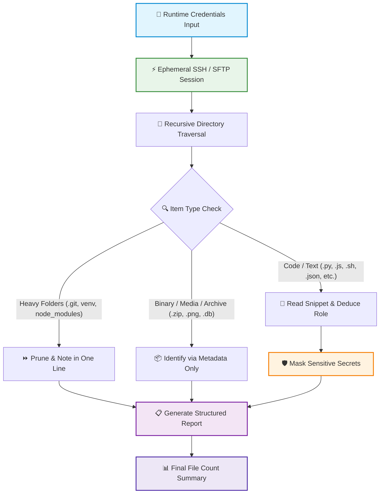

<div align="center">

# 🔍 SFTP Directory Audit Skill

**An autonomous AI agent skill for safe, read-only remote server inspection & code explanation.**

[](LICENSE)
[](https://github.com/biswaadev/sftp-directory-audit/stargazers)
[](https://github.com/biswaadev/sftp-directory-audit/network/members)
[](https://github.com/biswaadev/sftp-directory-audit/issues)
[](https://github.com/biswaadev/sftp-directory-audit/commits/main)

<p align="center">
  
  
  
  
</p>

[Key Features](#-key-features) • [Architecture](#-how-it-works) • [Sample Output](#-interactive-sample-output) • [Installation](#-quick-installation) • [Usage Triggers](#-usage-triggers) • [Security](#-security--safety-guarantees)

---

</div>

## 🌟 Key Features

| Feature | Description |
| :--- | :--- |
| 🔒 **100% Read-Only Safety** | Strictly zero mutations. Never creates, modifies, renames, deletes, or changes file permissions. |
| 🛡️ **Automatic Secret Masking** | Auto-detects passwords, private keys, API tokens, and database URIs — masks them completely in the report. |
| ⚡ **Crisp, No-Nonsense Explanations** | Delivers 1–2 lines explaining exactly what each file does. No unsolicited refactoring advice or filler text. |
| 🧹 **Smart Dependency Pruning** | Automatically skips heavy clutter folders (`node_modules`, `.venv`, `.git`, `__pycache__`, caches) while reporting them in one line. |
| 🌐 **Bilingual (Hinglish + English)** | Fluently handles queries in plain English, Hinglish, or Hindi with a respectful, direct tone. |
| 🧠 **In-Memory Credential Handling** | Passwords and private keys are never persisted to disk, session logs, or files. |

---

## 🔄 Dynamic Workflow Pipeline



---

## 📊 Interactive Sample Output

<details open>
<summary><b>🔹 Example 1: Web Application Audit (Click to Collapse)</b></summary>

```markdown
📁 project/src/
- auth.py: Handles user JWT authentication and password hashing
- database.py: Configures SQLAlchemy engine and connection pool
- config.json: Application settings (contains masked API keys)

📁 project/src/utils/
- logger.py: Formats and routes application logs to stdout
- helpers.py: Helper functions for string formatting and date parsing

📁 project/node_modules/ (skipped - dependency folder)
📁 project/.venv/ (skipped - virtual environment folder)

✅ Checked 14 files across 3 directories.
```

</details>

<details>
<summary><b>🔹 Example 2: Container / Hosting Volume Audit</b></summary>

```markdown
📁 /var/lib/pterodactyl/
- states.json: Stores live running/offline status of each container
- wings.db: SQLite database storing Wings daemon activities and logs

📁 /var/lib/pterodactyl/backups/
- c8c524fb.tar.gz: Compressed server volume full backup archive

📁 /var/lib/pterodactyl/volumes/3549ec41/
- main.py: Telegram bot manager script that hosts user bots
- requirements.txt: Python dependencies list (pyTelegramBotAPI, Flask, psutil)
- bot_data.db: SQLite database storing bot user configs and process IDs

✅ Checked 3 files and 1 volume container.
```

</details>

---

## 🚀 Quick Installation

Select your AI coding assistant environment:

### 1. Google Antigravity / Gemini CLI
```bash
# Global user skills directory
git clone https://github.com/biswaadev/sftp-directory-audit.git ~/.gemini/skills/sftp-directory-audit

# Workspace-specific skills directory
git clone https://github.com/biswaadev/sftp-directory-audit.git .agents/skills/sftp-directory-audit
```

### 2. Claude Code
```bash
# Global Claude skills directory
git clone https://github.com/biswaadev/sftp-directory-audit.git ~/.claude/skills/sftp-directory-audit
```

### 3. Cowork / Custom Agent Directory
```bash
git clone https://github.com/biswaadev/sftp-directory-audit.git path/to/your/agent/skills/sftp-directory-audit
```

---

## 💬 Usage Triggers

You can activate this skill naturally in your chat session using English or Hinglish:

<div align="center">

| English Prompts | Hinglish / Hindi Prompts |
| :--- | :--- |
| *"Audit remote directory `/var/www/my-app` over SFTP."* | *"Server ki directory check karo ek ek karke konsi file kya karti hai.*" |
| *"Inspect `/etc/nginx` on my VPS and explain what each file does."* | *"Ye remote folder check karke batao konsi script kis kaam ki hai."* |
| *"Connect to 54.206.35.63 over SFTP and audit `/home/user/bot`."* | *"Server pe check karo konsi .py aur .js file kya kaam kar rahi hai."* |

</div>

---

## 🔒 Security & Safety Guarantees

> [!IMPORTANT]
> **Zero Credential Persistence**: Passwords and SSH private keys provided during the prompt are held strictly in temporary execution memory and discarded when the turn completes. Nothing is ever written to disk or recorded in git.

> [!NOTE]
> **Strict Boundary Enforcement**: The crawler never navigates to parent directories (`..`) or follows symbolic links that resolve outside the requested root folder.

> [!TIP]
> **Safe Large Directory Handling**: For directories exceeding 500 files, the audit batches the analysis folder-by-folder to maintain responsive agent output and stay well within context token limits.

---

## 📄 License

This project is open-source and available under the **[MIT License](LICENSE)**.

Developed & Maintained by **[Biswaa Dev](https://github.com/biswaadev)**.
